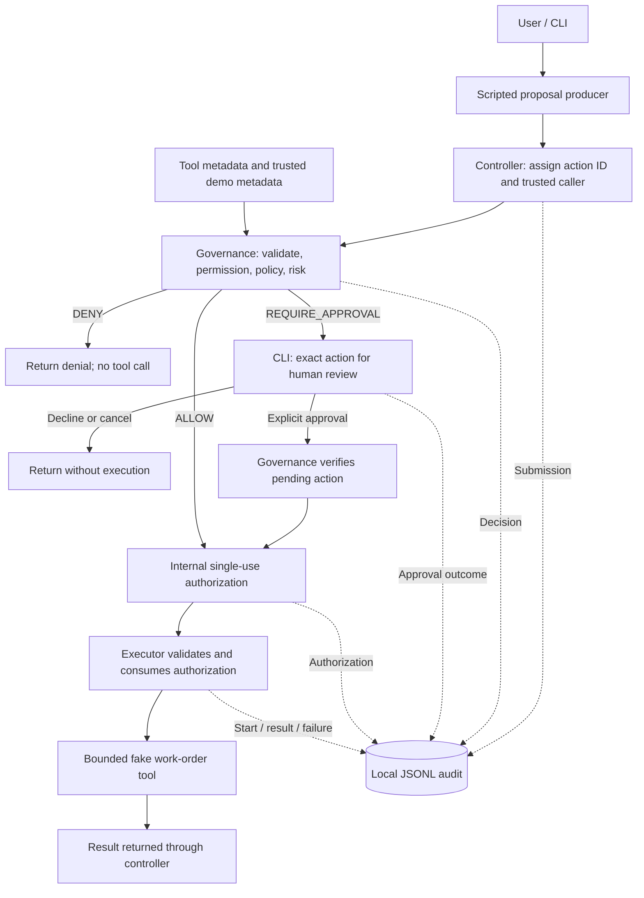
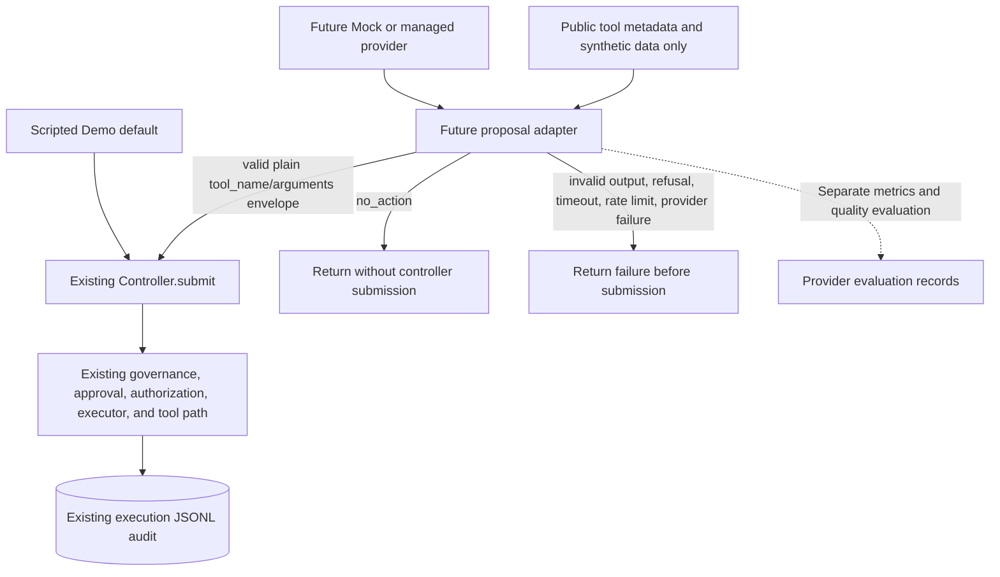

# Architecture

## Scope and trust model

The Python 3.12+ process hosts a CLI, a scripted proposal producer,
deterministic governance, an executor, bounded demo tools, and a JSONL audit sink.
These are logical responsibilities; this document does not require one package or class
per component. Milestones 2A, 2B, 3A, 3B, 3C, 4A, and 4B are approved and committed.
Milestone 4B provides bounded proposal admission, controller, and local terminal I/O.
Milestone 4C end-to-end verification has passed, as summarized below. Milestone 5A
approved and documented the provider/model proposal boundary. Milestone 5B.1
implements its offline provider interface, Mock Provider, and structural adapter.
Milestone 5B.2 adds an optional Groq provider with offline SDK/transport verification.
The 4B section records the current scripted CLI integration; the 5B.1 section
records the host-facing interface. No live inference or provider CLI wiring has
been performed. Earlier milestone sections describe their original increments.

Proposals are untrusted input. The application supplies caller context, policy,
resource metadata, approval input, and authorization. Arbitrary malicious code
inside this process is outside the threat model. This is an MVP/prototype, not
a production-ready system or security sandbox. Its controls apply through the
defined interfaces; a coding change that adds a bypass defeats that boundary.

## Planned components and boundaries

| Component | Responsibility and boundary |
| --- | --- |
| Proposal producer | Emits tool names and arguments; initially scripted, later replaceable by a model adapter. Receives descriptions and results, never executable handlers or tool credentials. |
| CLI/controller | Assigns action IDs, attaches a configured caller, coordinates evaluation and execution, and collects human input. It cannot grant itself execution permission. |
| Contracts and tool registry | Describe tools, validate argument schemas, and resolve bounded targets. Agent-facing metadata is separate from the execution-side handler mapping. |
| Governance | Checks permission, evaluates deterministic policy and risk, records decisions, processes required approval, and issues internal authorization. Work-order rules are supplied by the demo layer. |
| Approval interface | Shows the exact validated action and its consequence; accepts explicit human approval or decline through the terminal. Proposal text is never approval evidence. |
| Executor | Resolves and consumes internal authorization, loads the authorized action, records execution start, and invokes the registered handler. It does not accept replacement arguments. |
| Demo tools and data | Implement the two bounded work-order operations over fake local fixtures. No paths, credentials, endpoints, or real industrial resources come from proposals. |
| Audit sink | Appends correlated lifecycle events to local JSONL. Required pre-execution writes gate progress toward dispatch. |

Milestone 5A leaves every current component unchanged. A future
provider-independent proposal adapter is a proposal producer, not an execution
component. Scripted Demo remains the default. The adapter may support an offline
Mock Provider and, only after separate authorization, an optional managed API
provider. It receives public tool metadata and may receive only synthetic industrial
data; it never receives handlers, credentials, private policy configuration, audit
logs, authorization references, or other trusted execution state.

Only the execution side imports and invokes tool handlers. The controller calls
the executor with an authorization reference, not with a handler or raw action.
Governance reads trusted resource metadata without executing the proposed tool.



The audit arrows show event ownership, not optional logging: required records
must be written successfully before the handler can run.

### Milestone 5A planned provider-to-controller flow

The following records the 5A design; 5B.1 implements only its offline interface,
with host-controlled submission as described below. The model/provider
is an untrusted proposal source. It cannot approve, authorize, choose caller context,
classify risk, set policy, invoke a handler, or interact with the executor.



The adapter preserves the current strict proposal envelope; it does not introduce a
trusted `ProposedAction` or `ActionRequest`. For a validly structured unknown tool
or protected target, the host submits the adapter's envelope and lets deterministic
governance reject it. Conversely, `no_action`, invalid provider responses, refusals,
timeouts, rate limits, and other provider failures stop before `Controller.submit`:
they create no action ID, controller submission, fabricated tool call, or execution
JSONL lifecycle event. No automatic provider fallback or retry is permitted,
especially after submission.

Provider metrics and model-quality evaluation are separate from the execution JSONL
audit; they never grant authority or recreate an execution attempt. Groq Free and
GPT-OSS 20B are only experimental candidates. The current experimental budget is
zero, and any future live API work must first validate actual quota, billing, privacy,
and model support.

### Milestone 5A planned single-session lifecycle

One sequential session continues to own one audit writer, authorization service,
fake-work-order fixture, executor, and controller. A future adapter is attached as
an alternate proposal producer; it does not own or recreate any of those components.
Provider errors must leave trusted state intact: they cannot clear action-ID tombstones,
restore consumed references, reset stale-baseline state, or retry a submitted or
uncertain effect. A valid adapter proposal follows the unchanged controller path and
therefore uses the fixed trusted caller and current service state. Scripted Demo
remains the default until later implementation authorization.

### Milestone 5B.1 offline provider interface and Mock Provider

`provider.py` defines the synchronous ProposalProvider protocol, immutable
ProviderRequest, fixed ProviderFailure codes, and data-only ProposalAdapter.
`mock_provider.py` supplies a simple configured response or failure. Module
placement is for readability and supplies no security isolation. Neither module
imports a controller, authorization service, executor, policy, audit sink, or handler.

The trusted host supplies a plain prompt of 1–4096 characters containing only
public/synthetic data and a tuple of existing immutable ToolDefinition descriptions.
These checks do not detect embedded secrets; the host must curate content. Never
provide ToolRules, caller context, private policy/resource metadata, credentials,
audit logs, or authorization references. ProviderRequest is input data, not action
validation or execution authority.

ProposalAdapter.propose(request) calls the provider once. None alone means
no_action; the string "no_action" is invalid output. Otherwise the adapter reuses
parse_proposal to return a copied plain tool_name/arguments envelope. It neither
creates an ActionRequest or UUID nor submits anything. Unknown tools, unknown
targets, protected mutations, and invalid tool semantics remain for governance.
Malformed output raises ProviderError(INVALID_OUTPUT). Refusal, timeout, rate
limit, and unavailable errors use fixed codes. Unexpected ordinary exceptions
become UNAVAILABLE, built-in TimeoutError becomes TIMEOUT, and interruptions
propagate. Public messages contain fixed codes only. Original exception context
can remain in private host diagnostics; never render or audit raw tracebacks.
The adapter has no wall-clock timeout. The optional 5B.2 provider below adds finite
transport phase timeouts, not a total deadline.

Only the trusted host submits a non-None proposal through its existing controller:

```python
from controlled_agent.demo import TOOLS
from controlled_agent.mock_provider import MockProvider
from controlled_agent.provider import ProposalAdapter, ProviderRequest

request = ProviderRequest(
    prompt="Read synthetic work order WO-1001.",
    tools=tuple(rule.definition for rule in TOOLS.values()),
)
adapter = ProposalAdapter(MockProvider({
    "tool_name": "get_work_order", "arguments": {"work_order_id": "WO-1001"},
}))
proposal = adapter.propose(request)
if proposal is not None:
    report = controller.submit(proposal)  # Host's existing per-session controller.
```

The host must handle a provider error without submitting, and honor terminal
controller outcomes. It retains one writer/service/fixture/executor/controller
throughout the sequential session. Provider failure never clears tombstones,
restores consumed references, refreshes the review baseline, or retries an effect.
No-action and provider failure create no submission, action ID, or execution
JSONL lifecycle record. Provider metrics/model-quality records remain separate
and unimplemented. Scripted Demo remains the CLI default.

The basic MockProvider repeats its configured value on explicit calls; sequential
failure/success scenarios use a test-only provider. Tests use a context-managed
real temporary JsonlAuditWriter and read back records to verify action/caller
correlation and submission, decision, approval, issuance, and execution ordering.
They assert handler counts, fake state, admission state, no UUID creation before
submission, immutable public inputs, copied output, hard denials, missing
permissions, human approval/decline, sanitized failures, and interruptions.
A failure after an approved mutation leaves consumed references, tombstones,
persisted audit bytes, and stale-baseline state intact, with the queued response
unused until a new explicit host call.

Verification on 2026-10-18: the full suite passed 246 tests on Python 3.12.14
with `python3 -B -m unittest discover -s tests`: the unchanged 228 baseline
tests and 18 provider tests. These are automated offline interface/control-boundary
checks, not live model-quality, manual-human, or production verification.

This historical 5B.1 increment added no live API, SDK, dependency, CLI expansion,
automatic retry, fallback, autonomous loop, or session reset. The separately
authorized 5B.2 increment below adds only the optional provider/transport layer.

### Milestone 5B.2 optional one-shot Groq provider

`groq_provider.py` implements the existing synchronous ProposalProvider protocol.
It receives the unchanged ProviderRequest and returns a copied plain proposal or
None to the unchanged data-only ProposalAdapter. Only the trusted host submits
non-None output through its existing Controller.submit. It receives no controller,
caller, policy, permissions, protected-resource metadata, audit log, authorization,
handler, or session state. Public tool descriptions and synthetic prompts are the
only model inputs; curation, not structural validation, keeps secrets out of text.

The fixed experimental model is `openai/gpt-oss-20b`, not a production commitment.
One non-streaming chat completion uses JSON object mode, `n=1`,
`tool_choice="none"`, `include_reasoning=False`, `reasoning_effort="low"`, and
`max_completion_tokens=2048`. It sends no `reasoning_format`, tool registrations,
hosted tools, conversation history, feedback, or model-selected configuration.
Messages consist of a fixed wire contract plus public ToolDefinition metadata in
the system message and the synthetic prompt in the user message. Their serialized
UTF-8 size is capped at 32 KiB. Unknown tools/targets and flat argument claims remain
untrusted inputs for governance; provider-side decoding never decides semantics,
permission, policy, risk, or approval.

The entire model-authored content must be exactly one of:

```json
{"type":"proposal","proposal":{"tool_name":"get_work_order","arguments":{"work_order_id":"WO-1001"}}}
{"type":"no_action"}
{"type":"refusal"}
```

These are three alternatives, not a multi-record response. Keys are exact for
each variant and the proposal envelope. Only explicit wire no_action returns None;
the string "no_action", JSON null, empty/missing content, and failure never do.
Refusal produces REFUSAL. Proposal decoding reuses the existing 4 KiB bounded,
flat-scalar parse_proposal contract, copying its result. No repair, prose extraction,
fallback, or automatic retry is performed.

The documented SDK `chat.completions.with_raw_response.create` and response
`read()`/`close()` methods preserve the raw bytes for local parsing; SDK model
coercion and its ordinary JSON parser are not used. The response must have JSON
Content-Type, an object with exactly one choice at integer index zero, an assistant
message, and finish_reason `stop`. Explicit refusal or `content_filter` stops as
REFUSAL; length/missing/unknown finish reasons are INVALID_OUTPUT. Actual tool_calls,
function_call, executed_tools, MCP tool lists, nonempty reasoning, or annotations
are rejected. Documented absent/null/empty metadata is accepted where harmless;
API usage/ID metadata is ignored, not returned or audited. Outer API metadata is
not subject to the exact-key wire rule. Duplicate keys (including escaped aliases),
invalid UTF-8 or escaped surrogates, nonfinite/overflow numbers, excessive nesting
(over 16 containers), malformed JSON, and trailing documents are rejected at both
layers. Raw response and content limits are respectively 64 KiB and 8 KiB.

All response-size bounds apply **after buffering**, including SDK eager reads and
HTTP decompression; they are not transport memory-exhaustion protection. Phase
timeouts are connect=5s, read=20s, write=10s, pool=5s; these are **not a total
wall-clock deadline**. SDK max_retries and HTTPTransport retries are zero. Redirects
are disabled, the HTTPS endpoint is fixed, TLS verification is enabled, and HTTPX
trust_env is false (no ambient proxy configuration). The host supplies an explicit
nonempty API key; there is no environment credential lookup. Injected transport is
trusted test wiring, not model-selected configuration or a security sandbox.

GroqProvider owns the SDK/client/transport, supports `with`, and closes even after
failures. Close is idempotent and terminal; it never reopens a failed session.
Cleanup errors are sanitized and do not mask an existing exception/interruption.
APITimeoutError and HTTP 408 map to TIMEOUT; 429 to RATE_LIMIT; explicit refusal to
REFUSAL; invalid successful output to INVALID_OUTPUT; connection, other HTTP/SDK,
configuration, missing-dependency, and cleanup failures to UNAVAILABLE.
KeyboardInterrupt/SystemExit propagate. Fixed public codes contain no provider
bodies or raw exception text. Original exception context can remain private in
Python; hosts must never expose diagnostic tracebacks to users or execution audit.

The module does not log or alter application logging. It rejects the presence of
GROQ_LOG (which can configure logging at SDK import) and GROQ_CUSTOM_HEADERS before
import/construction, without reading their values. It refuses DEBUG-enabled Groq,
HTTPX, or HTTPCore loggers and descendants at construction and before requests.
Trusted host logging/environment configuration must remain fixed during the
synchronous call; this is not isolation from concurrent in-process mutation.
Credentials remain solely in trusted provider/HTTP configuration, never messages,
ProviderRequest, proposal results, execution audit, or public failure diagnostics.

The official SDK and HTTPX are pinned in the optional `groq` extra; base dependencies
stay empty, imports are lazy, and Scripted Demo/Mock usage needs neither package.
The maintenance benefit is the maintained transport/error API, without agent
dispatch machinery. Pins require review on upgrades; transitive versions are not
a lockfile. No application packaging or CLI behavior changes were added.

Offline verification on Python 3.12.14 with `-B`: 270 executed, 0 skipped, all passed
with Groq 1.7.0 and HTTPX 0.28.1. With `-S` (site packages unavailable), 253 executed
and passed, 17 optional-SDK tests skipped, 270 discovered. The 246-test 5B.1 baseline
is unchanged. New tests use the actual SDK and MockTransport with blocked sockets
and DNS and dummy keys. They check request parameters, one HTTP attempt, queued
success unused after failure, failure mapping, decoding, cleanup, no unsafe logging,
and dependency-free imports. Real temporary JSONL is read back for action/caller
correlation and lifecycle order; handler counts, approval, denial, state, tombstones,
and consumed authority are checked. Failure/no_action creates no submission, UUID,
or lifecycle records. Failure after a mutation preserves stale-baseline behavior.

No live request, actual account, credential, billing, model quality, or production
behavior was verified. A separately authorized zero-budget live smoke test requires
checking the actual account tier/quota and spend controls, current model availability
and permissions, and account data-retention/ZDR controls first. Public advertised
limits do not prove an account's entitlement or zero cost. Retention exceptions and
usage metadata must be reviewed; no real industrial or confidential inputs are
permitted. Result feedback, metrics, loops, fallback, and provider CLI wiring remain
deferred. See decision 22 for official references and rationale.

## Minimal contracts

The table describes the intended control system. Milestone 2A implements the
base records and enums; Milestone 2B adds the governance result and evaluation.
Milestone 3A adds trusted issuance/consumption; 3B adds human approval using
injected I/O. Milestone 3C adds dispatch and fake tools. Milestone 4A adds the
separate JSONL writer. Milestone 4B connects them through the controller and CLI.

| Concept | Minimum content and ownership |
| --- | --- |
| Proposal | Untrusted tool name and arguments. Unknown fields, including approval or permission claims, do not confer authority. |
| Submission envelope | Host-generated action ID and trusted caller context, assigned before parsing or validation. Invalid input still has an ID. |
| `ActionRequest` | After governance: validated tool identifier, canonical arguments, resolved target identifier, action ID, and trusted caller. Stored as an immutable snapshot; the target is derived from validated arguments, not independently supplied. Construction alone does not establish this validation. |
| `Permission` | A configured allowlist linking the trusted caller to tool capabilities. No match means deny. |
| `Policy` | Deterministic application rules that inspect the validated request and trusted context; hard-deny rules take precedence over approval. |
| `Risk` | A deterministic classification of the action and trusted target context, used by policy and recorded with the decision. It is not fixed per tool and never grants permission. |
| `GovernanceResult` | Action ID, a `Decision` outcome (`ALLOW` / `DENY` / `REQUIRE_APPROVAL`), risk when classification is possible, and a stable uppercase reason code plus readable explanation. Implemented in Milestone 2B; a decision is not an execution credential. |
| Execution authorization | Governance-owned record referring to the exact validated request, with usable/consumed state. Pending or denied requests provide no usable execution authorization. The executor receives only an internal opaque reference. |
| `AuditEvent` | Event type, timestamp, action ID, trusted caller when known, and relevant decision, approval, or execution details. |

Malformed or unresolved submissions receive a `DENY` decision with a validation
reason. They do not require a fabricated validated request or risk value. If the
tool and target can be safely resolved as a protected or critical mutation, it
remains HIGH risk and denied even when arguments or permissions also fail.

### Milestone 2A contract implementation

The flat `controlled_agent/` package contains `__init__.py` and `contracts.py`.
Contracts use frozen, slotted, keyword-only standard-library dataclasses and
string enums. Mapping payloads are recursively copied into read-only mapping
proxies; lists become tuples. This detaches each record from mutable input and
preserves an immutable snapshot of JSON-compatible data. It does not perform
domain normalization or semantic tool-argument validation. Caller identifiers,
tool names, targets, and descriptions must be plain strings; string subclasses
are rejected because they can retain mutable attributes or live references.

| Implemented contract | Contents and limits |
| --- | --- |
| `CallerContext` | Required `caller_id` string. No permission list or authentication behavior; the future application supplies trusted context. |
| `ActionRequest` | Required UUID `action_id`, `tool_name`, argument mapping, and `CallerContext`; optional target identifier for later trusted resolution. Construction checks structure, not whether the tool, arguments, caller, or target are allowed. |
| `Decision` | Exactly `ALLOW`, `DENY`, and `REQUIRE_APPROVAL`. It is the outcome enum, not a governance result or authority. |
| `Risk` | `LOW`, `MEDIUM`, and `HIGH`, with no numeric ordering or automatic authorization meaning. Milestone 2B supplies classification through domain policy functions. |
| `ToolDefinition` | Name, description, and immutable argument-schema metadata. No handler, fixed risk, schema evaluator, or registry behavior. |
| `Authorization` | UUID authorization identifier, complete immutable `ActionRequest`, and `AuthorizationState` (`USABLE` or `CONSUMED`). This is a data record only; constructing it does not grant execution rights. |
| `AuditEvent` | UUID action ID, `AuditEventType`, timezone-aware timestamp defaulting to UTC, optional caller, and immutable details. The nine event types below are represented; no logger or event-payload policy is implemented. |

Action IDs are supplied by trusted application code before parsing, so malformed
input can be correlated without constructing an `ActionRequest`. The contracts
check UUID representation but cannot prove its provenance; ID generation and
submission handling are deferred. Likewise, the optional target is intended to
be derived by trusted resolution, not to create independent authority for a
model-supplied target. Milestone 2B checks any supplied target against the target
derived from arguments. Authorization must eventually bind the semantically
validated, resolved request, not merely any structurally valid record.

There is no authorization issuance, consumption, state-transition method, or
trusted registry in Milestone 2A. `USABLE` records created by callers are data,
not execution credentials. The future executor must resolve an internal
reference against governance-owned state. Audit events accept timezone-aware
timestamps from other zones as well as UTC; JSONL serialization and event-specific
payload requirements remain deferred.

Neither an `authorization_id` nor `AuthorizationState.USABLE` proves trusted
issuance. The future executor must not accept a supplied `Authorization` object
as authority; it must retrieve the record through its internal reference boundary.
The record is internal data, not agent-facing metadata. `USABLE` on a supplied
record is an unverified label. Its UUID is not automatically a registered
execution reference, and construction does not enforce identifier uniqueness.
Those guarantees belong to the Milestone 3A service's trusted issuance state.

`AuditEvent.details` imposes JSON-like structure and immutability only. Sensitive
payload/result retention and redaction policy belongs to later event producers;
the contract neither selects retained fields nor detects secrets.

`ToolDefinition` has no handler, handler-reference, or credential field. Metadata
authors must nevertheless keep secrets and internal execution references out of
descriptions, schema text, defaults, and examples. Structural checks reject live
objects but cannot detect secrets embedded in otherwise valid text. No secret
scanner, reference resolver, or payload-storage policy is part of these contracts.

### Milestone 2B governance implementation

`governance.evaluate_action` is a domain-neutral evaluation function accepting a
host-assembled `ActionRequest` and trusted tool rules, permission sets, and resource
metadata. Caller identity and the action ID are trusted application inputs; this
API does not authenticate them or deserialize model output. Non-`ActionRequest`
input raises `TypeError` without an outcome or authority. Semantically malformed
records return `DENY`. Milestone 4B supplies submission IDs through the controller
and structural parsing/audit admission through the authorization service.

Internal `ToolRules` combines public `ToolDefinition` data with three trusted pure
functions: argument validation, target resolution, and contextual policy
evaluation. It contains no tool handler and must not be exposed as agent metadata.
The descriptive schemas are not interpreted by a general JSON Schema engine;
small explicit demo validators enforce their documented required fields, string
types, status values, and rejection of extra arguments.

Evaluation looks up the tool and resolves a known target from arguments, then
evaluates policy using trusted resource metadata and a separate request snapshot
with that target. Policy must safely handle incomplete arguments. A policy DENY
returns immediately, so an identifiable protected mutation stays HIGH / DENY even
with invalid status, mismatched supplied target, or missing permission. Otherwise,
a target mismatch, invalid arguments, or missing permission denies the action in
that order. A favorable policy outcome also requires a known risk. Risk never
bypasses any check. The original request and demo metadata remain unchanged.

The supplied `ActionRequest.target` is never a fallback when argument resolution
fails. Neither that field nor argument claims such as `target`, `protected`,
`risk`, `approved`, or `decision` manufacture resource metadata. The HIGH-risk
protected denial requires both a safely resolved target and trusted metadata
identifying protection or criticality. A protected-looking ID without that
metadata fails closed without inventing a HIGH classification. Callback names or
code strings in arguments are inert extra fields, never dynamically resolved.

Policy returns only a proposed `GovernanceResult`; the core checks its action ID
and applies the remaining gates. Missing/invalid policy results fail closed.
Ordinary configuration/callback exceptions become `GOVERNANCE_ERROR` without
exposing exception text; cancellation interrupts evaluation and yields no rights.
Configuration and callbacks are trusted, fixed during evaluation, and must be
pure. This is not containment for arbitrary malicious Python callbacks.

Core reason codes are `UNKNOWN_TOOL`, `INVALID_TARGET`, `TARGET_MISMATCH`,
`INVALID_ARGUMENTS`, `PERMISSION_DENIED`, `POLICY_UNRESOLVED`, and
`GOVERNANCE_ERROR`. Demo policy codes are `READ_ALLOWED`,
`UPDATE_REQUIRES_APPROVAL`, `PROTECTED_TARGET`, and `TARGET_NOT_EDITABLE`.
Unknown tools or unresolved targets have no risk; resolvable validation/permission
denials retain the contextual risk when available. Codes, rather than explanation
text, are the machine-readable interface.

`demo.py` supplies two immutable fake resource records, permission sets for
`demo_operator`, descriptive tool schemas, and pure work-order policy functions.
Missing protection/editability metadata cannot permit an update; either a true
protected flag or a true critical flag independently hard-denies it. `DENY` has
no approval override API. `ALLOW` and `REQUIRE_APPROVAL` are evaluation data only;
no pending approval, authorization, tool invocation, or audit write occurs.

### Milestone 3A trusted authorization service

`authorization.AuthorizationService` is a host-only, domain-neutral service with
one private registry per application run. Construction snapshots the tool mapping,
permission sets, and nested resource metadata; trusted callback closures must
remain fixed and pure. A required synchronous `audit_write(AuditEvent)` callable
must return `None` only after the required write/flush succeeds, otherwise raise.
There is no default writer. Milestone 4A supplies a separate context-managed
JsonlAuditWriter that also requires per-event fsync. Test recorders are not
production auditing. Callback purity and correct sink wiring remain host responsibilities.

`issue(request)` accepts only a host-assembled `ActionRequest`, never a result,
authorization record, approval flag, or per-call configuration. It returns a tuple
of reportable `GovernanceResult` and a separate host-only reference or `None`.
The tuple and reference must never reach the proposal producer. Trust comes from
internal evaluation and private registry membership, not dataclass construction,
UUID representation, or a caller-supplied result.

The public `evaluate_action()` API is unchanged. Its internal evaluation path now
retains the exact resolved snapshot only after all semantic validation and
permission gates pass. The validator sees that snapshot's arguments. The service
calls this path itself and stores that same action object, without a second
evaluation or target resolution during issuance/consumption. DENY has no retained
validated action, but internal evaluation separately returns a known resolved
target for audit context when resolution succeeded. That identifier does not
assert argument validity or permission. Without 3B approval configuration,
REQUIRE_APPROVAL returns no reference and creates no pending review or approval evidence.

Issuance ordering:

1. Reserve the action ID before calling any audit or policy code. All admitted IDs
   remain reserved until process exit, even for denial, failure, or interruption.
2. Write `action_submitted` with a bounded registered tool selection explicitly
   labeled as a submission claim, without an argument dump; evaluate; write
   `governance_decision`. A duplicate ID is audited as a duplicate denial and
   raises `DuplicateActionError`, without touching previously issued authority.
3. ALLOW can continue directly; 3B additionally permits explicitly approved
   REQUIRE_APPROVAL actions through the gates below. Construct internal record data; write
   `authorization_issued` with retained tool/target identifiers, caller, action ID,
   and an auditable UUID. Arguments stay in the exact private action record;
   validation alone does not make them safe to log. The UUID is not an execution reference.
4. Publish a fresh identity-bound opaque reference in the private registry. If
   publication or return preparation raises, including interruption, remove any
   partially inserted entry and retain the reserved ID. A successful issuance
   audit alone never proves live authority and cannot be replayed to recover it.

`consume(reference)` is reserved for the execution side. It accepts only an exact
registered reference object from this service; supplied records, UUIDs, copies,
unknown references, and cross-registry references fail. It marks the entry
consumed before updating its descriptive record or returning the stored action.
Even an interruption during that update leaves the entry consumed. Consumption
accepts no replacement arguments or action and performs no revalidation.

Rejected consumption writes `execution_blocked`, using the originating action ID
for a known consumed reference or a fresh host ID for an unknown attempt. It never
serializes the supplied reference. Audit failure raises without returning an
action. Public consumption emits no execution-start event and does not dispatch.
The 3C executor consumes and successfully writes `execution_started` through the
configured sink before invoking its handler; failure never restores the reference.

Operations are sequential and non-reentrant, not thread-safe. A nested call sets
an outer-failure flag and raises before callbacks or registry changes. Even if a
callback catches that rejection, the outer operation aborts at the next gate.
Nested rejections are not recursively audited. In-flight IDs remain reserved;
IDs in rejected nested calls are not admitted. Ordinary audit failures raise
`AuditWriteError`; interruptions propagate after cleanup. No automatic retry,
registry reset, persistence, or rights recovery exists. The host must not create
multiple live issuance authorities for the same run. Terminal entries accumulate
in memory for the lifetime of this bounded prototype.

This service has no handlers, concrete terminal I/O, CLI, model integration, or concrete
audit storage. Runtime reflection or malicious trusted callbacks can bypass Python
privacy; those remain outside the application's interface-level threat model.

#### Milestone 3A audit retention policy

Action IDs, timestamps, trusted caller context, decisions, risk, and stable reason
codes remain correlated event metadata. The host must configure public,
non-sensitive caller/tool/resource identifiers and reason codes. This is a trust
requirement, not automatic secret detection.

- `action_submitted.submitted_tool_name` is the untrusted selection of a registered
  tool name. Unknown tool strings are omitted (`None`), even if syntactically valid.
  No submitted target claim or arguments are retained.
- `governance_decision.tool_name` identifies the registered tool when known.
  `resolved_target` comes from the same evaluation's resolver and known resource
  metadata, never from the request's target claim. It can be present on DENY,
  including protected mutations and invalid arguments. `action_validated` is true
  only when all validation and permission gates passed; REQUIRE_APPROVAL can be
  true without granting any authority. Duplicate submissions are not evaluated,
  so their target is absent and `action_validated` is false.
- Retained tool/target identifiers must be 1–128 ASCII letters, digits, underscores,
  periods, colons, or hyphens. Other identifiers are omitted (`None`), not truncated
  into misleading identities. Omission changes only logging, never governance or
  the exact action in the registry.
- No event produced by this service retains arguments, arbitrary proposal fields,
  resource metadata, policy explanations, or opaque references. Issuance retains
  only the auditable UUID and bounded tool/target identifiers in its details.

These records identify attempts and outcomes, not the complete proposed payload.
For example, they do not distinguish proposed status values on the same target
except by action ID. Exact arguments stay in the private immutable action record
for issued actions. Any later argument/result retention needs an explicit safe
field policy; audit data can never recreate execution authority.

### Milestone 3B synchronous human approval

The host may supply both `approval_formatter` and `human_approval` when constructing
the service. Supplying only one is an error. `HumanApprovalAdapter` holds trusted
`display(ApprovalReview)` and `read_response()` callbacks; no default input source
is supplied by the service. Milestone 4B supplies the concrete terminal adapter
from the CLI. Callbacks must be synchronous.
The service controls their ordering and checks reentrancy after each callback.
No review dependencies, responses, decisions, or replacement actions are accepted
as per-request issuance arguments.

After an internally evaluated REQUIRE_APPROVAL decision is audited, the service
creates one private pending entry referencing the exact validated action and
governance result. DENY cannot create pending state or invoke review callbacks.
There is no public approval endpoint, exposed pending token, resume operation,
or queue. The existing non-reentrant operation spans the entire exchange.

1. Write `approval_requested` before any formatter/display/input callback. It
   records that review was requested, not proof of successful presentation.
2. Call the trusted formatter with the exact retained action and the immutable
   resource snapshot already used by governance. There is no second resolution
   or governance evaluation. The formatter returns `ApprovalChange` data: current
   state, proposed state, and intended effect. The service separately constructs
   an immutable `ApprovalReview` containing the original action identity, so the
   formatter cannot replace the action used for issuance.
3. Display the review, requiring a `None` return after successful presentation,
   then read one fresh human response. Action ID, trusted caller, canonical tool,
   target, and exact change must be presented. The demo formatter derives status
   fields from canonical arguments and trusted metadata and uses a fixed effect
   template; it does not accept proposal-authored descriptions as instructions.
4. Irreversibly close the pending entry before writing `approval_result`. Only a
   plain string whose surrounding-whitespace-trimmed value is exactly `approve`
   is affirmative. `decline` refuses. Empty/None input cancels; any other object
   or text, including booleans, dictionaries, string subclasses, and uppercase
   `APPROVE`, cancels. No automatic reprompt occurs.
5. Only an affirmative response with successful result auditing may reach the
   existing authorization-issued audit and registry publication sequence. The
   original governance result remains REQUIRE_APPROVAL in the returned tuple;
   the separate reference represents issuance. All exact-action and one-use
   registry guarantees remain unchanged.

Approval result details use only fixed outcomes/reasons: `approved/HUMAN_APPROVED`,
`declined/HUMAN_DECLINED`, `cancelled/NO_RESPONSE`, `cancelled/INVALID_RESPONSE`,
`cancelled/END_OF_INPUT`, `cancelled/INTERRUPTED`, or `error/REVIEW_FAILED`.
They retain the same bounded public tool/target context and correlation envelope;
raw responses, review text, current/proposed state, arguments, exceptions, pending
entries, and authorization references never enter these audit payloads.

EOF returns without authority. Ordinary review failures attempt a sanitized error
result and raise `ApprovalError`; interruptions attempt a cancelled result and
propagate. Pending state closes before these writes and is cleared on every exit.
A failed required audit is never retried recursively. If cancellation auditing
also fails during an interruption, the original interruption propagates with the
audit failure chained. Reentrancy poisons the outer operation; after detection no
further review callbacks or outcome-audit attempts run. Consequently failures may
leave an incomplete audit trail, never usable new authority. Host exceptions can
retain diagnostic causes and must not be exposed as raw agent-facing tracebacks.

The original action ID remains reserved after every outcome. No pending state or
approval can be replayed, resumed, imported, or reused after failure. Publication
failure, including partial insertion after a successful issuance audit, uses the
existing cleanup boundary and cannot reopen approval or reissue the same ID.

Display/input and formatter callbacks are trusted application code, not a security
sandbox. Formatters may describe only the canonical action; display callbacks must
faithfully present it, and readers must collect fresh human input rather than
proposal text, cached responses, or defaults. The service does not authenticate
humans, verify screens, or sandbox malicious callbacks. Current-state display is
the fixed resource snapshot captured at service construction: live freshness,
concurrent changes, and TOCTOU protection are explicitly deferred. No handler or
resource mutation occurs during this workflow.

### Milestone 3C executor and bounded fake tools

`Executor(authorization=service, handlers=...)` snapshots a trusted handler mapping.
The public execution method takes exactly one reference. It never accepts a raw
action, Authorization record, governance result, approval flag, or replacement
arguments. `ToolDefinition` and `ToolRules` remain separate from executable handlers.
The core contains no work-order rules and performs no dynamic handler imports.

The service's private `_execution_scope` holds the existing operation guard across
consumption and the entire executor call. Public `consume()` retains its previous
behavior via the same private consumption implementation. Issuance, public
consumption, and any executor using this service share the guard. A caught nested
rejection still poisons the outer call. Nested calls do not recursively audit, admit
action IDs, or consume other references. The service itself still does not dispatch.

1. Identity-check and burn the reference before returning the exact stored action.
   Invalid/replayed references are audited by consumption, using the known action
   ID or a fresh host-generated attempt ID. The executor does not duplicate that log.
2. Select the fixed handler by the stored tool name. Missing handler: audit
   execution_blocked/HANDLER_UNAVAILABLE and raise with no dispatch. Consumption
   is permanent even for this configuration failure.
3. Write execution_started successfully through the service's synchronous writer.
   Check the shared reentrancy guard before calling the handler. Audit failure or
   interruption prevents dispatch; no reference or action ID is restored.
4. Invoke once with the same immutable action used in governance and human review.
   No second resolution, policy evaluation, or replacement arguments are accepted.
5. Freeze returned mapping data, then record execution_succeeded. A handler error
   instead attempts execution_failed. A detected poisoned operation calls no more
   external callbacks, so its audit trail may end at execution start.

`ExecutionReport` is immutable host-facing data with action ID when available,
outcome, fixed reason code, optional immutable result, completion_audited, and
audit_failed. Outcomes mean no_dispatch, succeeded (handler returned normally),
rejected_without_mutation, or possibly_partial. A handler returning malformed result
data still completed; RESULT_INVALID reports the result-contract error separately
from its effects. Result data is never automatically logged or treated as authority.

Normal success returns a report. Ordinary errors raise `ExecutionError` carrying the
report and separate audit_error/handler_error diagnostic fields. Successful effects
can accompany a failed completion audit; no normal success return hides that failure.
KeyboardInterrupt/SystemExit retain their type with execution_report and diagnostic
attributes attached. An interruption of failure auditing does not hide an original
handler interruption. Interruption before consumption returns can lack an action ID
in the host report; this does not reopen a consumed entry. Diagnostic causes may
contain private data and must not be exposed as raw agent-facing tracebacks.

Handlers may raise `ToolRejected` with a fixed `RejectionReason` only before any
mutation. This is a trusted handler promise, not inferred rollback. Other handler
exceptions/interruptions are potentially partial even if a particular test handler
happened to do nothing. If completion auditing also fails, both errors remain
observable. No automatic retry, recursive logging retry, compensation, or restoration
of authority exists. Abrupt process death can leave effects and logs uncertain.

Execution audit details contain only bounded registered tool/resolved target,
fixed outcome, and fixed reason codes. No arguments, result mappings, raw errors,
review text, human responses, or references are logged. Start records describe the
pre-dispatch gate; they do not prove handler invocation. Failed required writes
cannot guarantee a durable record of their own failure. This milestone uses only
injected writers and introduces no concrete sink or durability claim.

`FakeWorkOrderTools(authorization=service)` owns private mutable statuses initialized
from WORK_ORDERS and captures that service's immutable resource snapshot as its
reviewed baseline. The host binds one fixture and one executor to the same service
per run. Do not recreate either object to reset state or discard tombstones.
The two handlers independently require known fixture IDs, exact target/argument
consistency, exact field sets, and supported statuses. Update also rejects protected,
critical, or noneditable fixtures using the fixed demo protection metadata.
Only status can mutate; reads return detached immutable snapshots of live fake state.

Immediately before assigning status, compare live status to the captured reviewed
baseline. Missing/malformed baseline fails safely; differing status raises
STALE_BASELINE before mutation. The normal fixture and review start open. After a
status-changing update, subsequent mutations are rejected for that run, including
new approvals and already-issued references; reads still work. Same-status updates
remain possible while baseline matches. Human presentation remains the fixed
snapshot and can be stale; the guard prevents executing that stale transition,
not displaying it. Baseline refresh, external freshness, concurrency, and general
TOCTOU protection are deferred.

Handlers, callbacks, configuration, and host wiring are trusted application code.
A direct malicious Python call can bypass authorization or mutate private state;
this is not a sandbox. Tool bounds reduce accidental misuse but do not authenticate
callers or grant authority. Dispatch is at most once per reference, not exactly-once
transactional execution. No new dependencies, CLI, network, storage, or real tools
are introduced.

## End-to-end flow

1. The controller assigns an ID and trusted caller to every proposal submission.
   The service reserves that ID and writes its safe submission record before parsing. An audit failure
   stops processing and is reported to the CLI with the action ID.
2. Governance resolves the tool and known target where possible and validates
   arguments. Invalid input cannot produce an executable request; valid input
   produces a canonical immutable request.
3. Governance checks the configured caller's permission. Unknown tools,
   unknown targets, invalid arguments, absent permissions, and unresolved rules
   require denial regardless of risk.
4. Domain-supplied deterministic rules classify risk using safely resolved
   action details and trusted metadata. Governance considers target, arguments,
   permissions, and policy together. A hard denial always wins; the same tool
   can receive different classifications and decisions. Record the decision.
5. `DENY` ends the attempt. `REQUIRE_APPROVAL` creates pending review state;
   it grants no execution authority. `ALLOW` can proceed to authorization.
6. For required approval, the CLI shows the canonical tool, exact work-order
   ID, current status, proposed status, and intended effect. Only an explicit
   affirmative response to that pending action counts. Record the result.
7. Governance issues authorization only after a permitted decision, any
   required approval, and required audit writes succeed. The authorized action
   is the same immutable snapshot used for evaluation and human review.
8. The executor validates the reference, consumes it once, and successfully
   records execution start before invoking the handler. A failed pre-execution
   write blocks dispatch and does not restore consumed authorization.
9. The executor records success or failure and returns the result through the
   controller. Handler errors do not restore authorization or trigger retries.

## Execution authorization and approval

Authorization binds the action ID, trusted caller, tool identifier, canonical
arguments, and resolved target. The executor loads those values from the
internal record; callers cannot swap in another work order or status. An
`approved=true` field, public `Decision` object, or raw `ActionRequest` is never
sufficient to invoke a tool.

Only governance may make an authorization usable. The executor may consume it,
but cannot create one. Missing, fabricated, pending, denied, or consumed
references fail before handler invocation. The executor must attempt an
`execution_blocked` audit event for each rejected call, using the originating
action ID when known. If there is no known originating action, the application
assigns a fresh host-generated action ID to the blocked attempt. Audit failure
must be reported through the CLI; the handler remains uninvoked.

Approval applies once to one exact pending action. Resolving approval closes that
pending review; governance may issue at most one execution authorization per
action ID. A consumed authorization cannot be reissued from the same decision
or approval. Any further execution attempt requires a fresh submission.

Decline, blank/default input, EOF, cancellation, or interruption never implies
approval. Editing the proposed action requires a new submission and governance
evaluation. There is no CLI override for a hard denial and no blanket approval mode.

Approval and authorization records exist only for the current process. Restart
invalidates them; the audit log is not used to recreate execution permission.
Actions run sequentially. There is no queue, parallel dispatcher, or automatic
retry. The internal reference representation remains an implementation detail;
cryptographic tokens or a separate authorization service are not required by
the current threat model.

## Domain boundary and demo conventions

The core understands actions, targets, permissions, decisions, and generic
policy results. It must not contain work-order IDs, status names, or industrial
conditions. The demo registers schemas, trusted fixture metadata, policy
functions, and handlers through explicit interfaces; no dynamic plugin system
or policy language is needed.

Confirmed demo setup and rules:

- One configured caller, `demo_operator`, has permission for both tools.
  Missing-permission tests use a restricted configuration, not a login system.
- `WO-1001` is editable; `WO-9001` is protected and critical.
  Only these fake resources are addressable. Protection metadata is trusted
  application data and cannot be changed by either tool or proposal arguments.
- Allowed reads are `LOW` risk → `ALLOW`; normal editable status updates with
  valid arguments and permission are `MEDIUM` risk → `REQUIRE_APPROVAL`;
  identifiable mutations of protected or critical targets are `HIGH` risk →
  `DENY`. These application risk labels are not an industrial safety assessment.
- The same update tool implements both mutation paths. Risk is context-sensitive
  and cannot grant permission or override a denial. A LOW-risk read without
  permission is still denied. Human approval can never override `DENY`.
- Approval and authorization stay in memory and expire on restart. Local JSONL
  audit logs persist; they cannot be used to restore execution permission.

Sample conventions (validation and metadata adopted in Milestone 2B):

- Both work orders start `open`.
- The update schema accepts `work_order_id` and `new_status`; the read schema
  accepts only `work_order_id`. Status values are `open`, `in_progress`, and
  `closed`. No arbitrary field updates or user-supplied resource paths exist.
- Milestone 2B work orders remain immutable in-memory metadata. Milestone 3C
  handlers change private per-run fixture status; only the audit log persists.
  They reject mutations when live status differs from the fixed reviewed baseline.
- A valid same-status update to an editable fixture with permission also
  requires approval. No industrial transition workflow is modeled in this MVP.
- Policy configuration and protection metadata are fixed during a run. Human
  review and execution are sequential. An earlier authorized update can make
  later or outstanding approvals stale; the handler rejects those mutations.

| Request / condition | Risk if classified | Outcome / required behavior |
| --- | --- | --- |
| Read `WO-1001` or `WO-9001`, with valid arguments and permission | LOW | `ALLOW`; execute once |
| Update `WO-1001` to any valid status, with permission | MEDIUM | `REQUIRE_APPROVAL`; execute only after approval |
| Any identifiable mutation of `WO-9001`, including closure | HIGH | Hard `DENY`; no approval prompt or handler call |
| Known tool without permission | From resolvable context | `DENY`; risk cannot bypass permission |
| Invalid status, unknown target/tool, or malformed input | HIGH for an identifiable protected/critical mutation; otherwise may be unclassified | `DENY` with validation reason; no handler call |
| Declined or cancelled pending approval | Original classification | No authorization and no execution |
| Missing, changed, or reused authorization | Not a new policy evaluation | Block execution before handler invocation |
| Required pre-execution audit write fails | Any | Stop without invoking a handler |
| Handler throws after dispatch | Original classification | Record failure if possible; report any uncertain effect; no retry |

## Audit behavior

Use an append-only application write pattern to a local JSONL file. This is not
tamper resistance: a local user or malicious in-process code can alter the file.
Recommended runtime output directory: `var/`, ignored by Git. Audit records are
data and never instructions, approvals, or replayable authorization.

The minimum event vocabulary is `action_submitted`, `governance_decision`,
`approval_requested`, `approval_result`, `authorization_issued`,
`execution_started`, `execution_succeeded`, `execution_failed`, and
`execution_blocked`. A malformed action appears as a submission followed by a
denial with a validation reason. Approval results distinguish approved,
declined, and cancelled. A denial does not produce an execution-started event.

Events share the action ID. Include bounded known tool and resolved target context,
risk and reason when available, and concise execution outcomes when implemented.
Milestones 3A and 3B follow the identifier-only retention policy above; they do not
log arguments or claim that a full action can be reconstructed from logs. Human
approval displays and binds the exact action held in trusted state. Retaining
any argument or result fields in later audit events requires an explicit safe
field policy. Avoid raw unbounded input dumps and credentials; validation alone
does not establish that operational data is safe to retain.

Required submission, decision, approval, authorization, and execution-start
records must be successfully appended, flushed, and fsynced by the 4A writer
before dispatch. Failure stops execution and raises to the trusted host; the CLI
surfaces a safe error and terminates the session. This does not promise survival of every OS or power failure.

If writing the result fails after a handler runs, the side effect cannot be
undone merely by failing the log write. Report the tool outcome if known and
the audit failure separately; otherwise report an uncertain outcome. Do not
retry automatically. A log ending at execution start is an incomplete attempt,
not proof of success or proof of no effect. Complete durable auditing cannot be
guaranteed when its storage itself is unavailable.

### Milestone 4A JSONL writer

`audit.JsonlAuditWriter(path)` is a context-managed callable supplied by the host
as the service's existing `audit_write(event)`. No control-module changes or default
writer are required. The host owns one writer per file/run, opens it before issuing
work, and closes it after service/executor use. All work remains sequential.

Each compact UTF-8 JSON object contains exactly `action_id` (canonical UUID text),
`timestamp` (aware event time normalized to UTC ISO 8601), `event_type`, `caller`
(public caller ID or null), and `details`, followed by exactly one LF. Timestamps
come from the event; wall-clock authenticity and monotonicity are not guaranteed.
The complete encoded record including LF is limited to 4096 bytes.

The sink requires exactly these detail keys, without dropping extras or filling
missing keys:

| Event | Retained detail fields |
| --- | --- |
| action_submitted | submitted_tool_name |
| governance_decision | decision, risk, reason_code, tool_name, resolved_target, action_validated |
| approval_requested | tool_name, resolved_target |
| approval_result | tool_name, resolved_target, outcome, reason_code |
| authorization_issued | authorization_id, tool_name, target |
| execution_started / execution_succeeded / execution_failed | tool_name, target, outcome, reason_code |
| execution_blocked, rejected reference | reason_code |
| execution_blocked, missing handler | tool_name, target, outcome, reason_code |

Caller/tool/target identifiers use 1–128 ASCII letters, digits, `_`, `.`, `:`, or
`-`; tool/target fields can be null exactly as producers emit them. Caller bounds
are newly enforced by the sink; an unsuitable host caller configuration now fails
persistence and therefore fails closed. Reason codes are 1–128 characters matching
`[A-Z][A-Z0-9_]*`. Governance codes remain domain-neutral; decision/risk labels,
approval outcome/reason pairs, execution outcome/reason pairs, validation booleans,
and descriptive authorization UUIDs are checked explicitly. Producers may already
omit unknown/unretainable tool/target claims as null; the sink itself never silently
redacts or drops submitted details. Resolved context does not imply validation.

The existing details mapping proxy is explicitly copied into a plain JSON object.
All current schemas are flat: there are no array, nested mapping, or numeric fields
apart from the validation boolean. Tuples/mappings in scalar fields, cycles,
nonfinite numbers, custom objects, extra fields, and malformed envelopes are rejected
without recursive conversion or `default=str`. There is no generic payload escape
hatch. No arguments, results, resource snapshots, review text, raw responses,
references, or exception messages enter records. Syntactic validation cannot detect
secrets in permitted public strings; safe configuration remains a host obligation.

Opening requires POSIX `O_NOFOLLOW`, a trusted path with an existing trusted parent,
and an owned regular file with exactly mode 0600. `os.open` uses append/create,
no truncation, and nonblocking mode so a FIFO cannot block before descriptor
validation. New files request 0600 subject to umask; a resulting unsuitable mode is
rejected without chmod. Ownership/mode/type checks and final-byte reads use the opened
descriptor; final symlinks are rejected. Nonempty files must end in LF. This checks
only the tail boundary, not historical JSON validity, completeness, or authenticity.
No ancestor/ACL security management, repair, or directory creation is performed.
The trusted parent/path and exclusive-writer assumptions exclude concurrent changes.

The writer validates and encodes the whole record before file I/O for that event.
An unbuffered binary append must return the full byte count, then flush and
`os.fsync` must succeed before returning None. Short writes are terminal, never
continued. Any validation/serialization/write/flush/sync exception or interruption
permanently poisons the instance. No automatic reopen, retry, truncation, tail
repair, or recursive failure logging occurs. Failed appends may leave partial or
complete records; even a complete issued event cannot recreate usable authority.

Close is idempotent and closes once; writes/context entry after close or failure
are rejected. Unbuffered I/O avoids deferred buffered writes during cleanup.
A close failure propagates if it is the only error. During context unwinding, the
original error/interruption wins and receives a fixed cleanup-failure note without
raw secondary diagnostic text. Underlying exception causes remain host-only.
Constructor failures also attempt descriptor cleanup without masking the original.

Per-event fsync improves persistence compared with flush alone; it is not an
absolute power-loss guarantee across filesystems, OSes, devices, or hardware caches.
The new file's parent directory is not fsynced. JSONL is not tamper-resistant or
transactional with tool effects, and the writer provides no exactly-once recovery,
rotation, locking, concurrent-writer support, cryptographic verification, or replay
of rights. Storage failure cannot guarantee a persisted account of that failure.
Completion failures preserve the existing executor's actual/uncertain effect report;
no rollback or automatic retry is introduced. Runtime files belong under the
already ignored `var/`, `audit/`, or `logs/` directories.

### Milestone 4B controller and local CLI

`python -m controlled_agent` runs an interactive terminal session. Startup owns one
JsonlAuditWriter, fixed demo configuration/caller, terminal approval adapter,
AuthorizationService, FakeWorkOrderTools, Executor, and Controller. No component is
recreated between choices. The demo's pure scripted_proposal function receives only
a menu choice and returns fresh data; it imports no handlers and receives no service,
writer, credentials, or references. Invalid menu choices and quit/EOF are UI control
inputs, not fabricated action submissions.

Controller.submit generates a UUID before inspecting proposal data, attaches its
construction-time CallerContext, and calls issue_proposal. The new host-only API
and existing issue(ActionRequest) share _admission (one _operation guard and _seen
set) and _issue_action (evaluation, exact action, approval, issuance, and cleanup).
An outer failure boundary also removes new authority if guard exit fails after
publication. Duplicate IDs across either API preserve earlier authority and cannot
be reissued. The controller has no admission registry or independent audit writer.

For proposal admission, reserve the ID and successfully write action_submitted with
submitted_tool_name=null before parsing. A fixed parser checks a plain dictionary
with exactly tool_name and arguments, a nonblank tool name of at most 128 characters,
and at most eight plain string keys of 1–128 characters. Argument values may be
strings up to 256 characters, signed 64-bit integers, finite floats, booleans, or null.
The compact UTF-8 encoded proposal must not exceed 4096 bytes. Nested containers,
custom objects/subclasses, cycles, nonfinite numbers, and extra envelope fields
fail structural parsing. No model-supplied identity, policy, target, metadata,
approval, handler, or audit path can enter trusted configuration. Scalar claims
inside arguments remain untrusted data for semantic governance checks.

MalformedProposal produces governance_decision with DENY/MALFORMED_PROPOSAL,
risk=null, tool_name=null, resolved_target=null, action_validated=false, and the
same host ID/caller. No ActionRequest is fabricated. Failure/interruption retains
the ID; interrupted parsing can leave only the submission event, never authority.
Structurally valid proposals become immutable ActionRequests with target=None;
existing governance alone resolves targets and retains semantically valid actions.
No new audit shape or retention policy is needed.

Controller holds references locally and immediately calls Executor.execute, with
no output callback or proposal access between issuance and execution. Non-issued
actions never call execute. Nested submissions during service/executor callbacks
hit the existing shared guard and poison the outer operation even if the nested
error is caught. ControllerReport carries fixed outcome labels, action ID, decision,
execution effect classification, audit-failure/terminal flags, and optional immutable
tool result data; no references or exceptions. Results remain untrusted data.
The CLI renders only known work-order IDs/statuses, not arbitrary mappings or errors.
Approval-not-granted groups decline/cancellation; exact details remain in the audit.

Menu choices read WO-1001, close WO-1001, and attempt to close WO-9001. Canonical
review shows ID, caller, tool, target, fixed reviewed baseline, proposed status, and
formatter-derived intended effect. Complete output must be written and flushed
before one response is read. The real CLI requires interactive stdin/stdout;
run_session accepts trusted injected streams for host tests. There is no automatic
approval or authentication. Service interpretation of plain-string approve is
unchanged. Terminal lines are bounded to 256 content characters; oversized input
stops the session without draining/reusing a remainder or approving a prefix.
Unterminated EOF lines cancel too.

Ordinary denials, approval-not-granted, and normally completed and audited known
no-mutation rejections return to the menu. Reentrancy or incomplete completion
processing terminates even when the handler rejected without mutation; that effect
classification remains separate from operational and audit failures.
Unexpected blocked execution, handler/review faults, audit failures, and
terminal errors terminate. Menu EOF exits; approval EOF first passes through the
service cancellation audit. KeyboardInterrupt keeps its type through control code,
then the CLI reports its attached effect/audit information and exits 130. SystemExit
also retains its type through control code; the CLI safely reports it and exits 1,
never printing a potentially sensitive exit message. Other
operational failures exit 1, CLI usage/noninteractive startup exits 2, normal exit
is 0. Close failures cannot erase already known effects; cleanup during an earlier
failure preserves that failure and reports the fixed cleanup-failure note when
output remains available. No raw diagnostic text is printed. Output failure itself
can prevent an error being displayed; the process still fails rather than retrying.

Read results reflect live fake state; review remains a fixed snapshot. A successful
status-changing update makes later mutations stale in that run. There is no baseline
refresh, service reset, retry, rollback, log-based recovery, model adapter, network,
concurrency, or dependency addition. The host provisions a trusted existing log
parent; --audit-path is startup configuration only. Runtime logs belong in ignored
directories. The unrelated pitch/speaker-guide artifacts remain outside this milestone.

## Verification and deferred choices

### Milestone 4C end-to-end verification

Verification passed on 2026-10-12 against committed Milestone 4B baseline
`8697607b3fe25ae3a84d6903ace0326ed79897b0`. The complete Python 3.12.14 suite
passed **228 tests** (`python3.12 -B -m unittest discover -s tests`). No production
code, tests, or dependencies changed during 4C verification or documentation closure.

The real `python3.12 -B -m controlled_agent --audit-path <temporary-path>` entry
point was exercised through automated pseudo-terminal input. A separate observed
`run_session` smoke run used injected streams and wrappers around the real fake
handlers to inspect call counts, state, and consumed references. These were
automated checks, not manual-human verification. Each run used isolated temporary
JSONL files and one application lifetime for the following sequence:

| Scenario | Result and observed behavior |
| --- | --- |
| Read WO-1001 | PASS: LOW/ALLOW; returned `open`. |
| Decline an editable update | PASS: decline audited; no issuance or handler call. |
| Approve an editable update | PASS: review/approval and required audits preceded execution; status became `closed`. |
| Attempt protected WO-9001 update | PASS: HIGH/DENY; no review prompt, issuance, or dispatch. |
| Approve another WO-1001 update | PASS: `STALE_BASELINE` rejection without mutation; authority remained consumed. |
| Read WO-1001 again | PASS: returned live status `closed`; normal session exit was 0. |

**Each main smoke run persisted 30 JSONL events across 6 distinct action IDs.**
Checks matched event order, `demo_operator` caller and action-ID correlation,
UTC timestamps, exact retained fields, the 4 KiB limit, and file mode 0600.
Arguments, results, review text, raw responses, and internal execution references
were absent from those logs. The observed run recorded two read calls and two
update calls (one success, one stale rejection), with all four authorizations
consumed. Final fake state was **WO-1001: closed; WO-9001: open**.

Additional checks passed: six malformed host proposals produced correlated
submission/DENY records with no handlers or rights; invalid menu input created no
action; approval EOF and Ctrl-C persisted cancellation without issuance and exited
0 and 130 respectively. A missing audit parent caused a sanitized failure and exit
1 without creating the directory or retrying. The automated suite also verified
mandatory audit failure gates, replay rejection, reentrancy termination, consumed
authority, and accurate post-dispatch effects without automatic retry. Fault tests
used temporary storage, not real user files. `git diff --check` passed, and the
four unrelated pitch/speaker-guide artifacts remained unchanged and unstaged.

This evidence supports a **local scripted demonstration**, not production readiness.
There is no human authentication or proof that a person viewed the review; approval
display uses a fixed snapshot with no external-state freshness guarantee. Fake
effects and JSONL writes are not transactional, and logs are not tamper-resistant
or execution authority. Flush/fsync does not provide absolute crash or power-loss
durability. Concurrent operation, real integrations, and containment of malicious
in-process code remain outside scope. No subsequent implementation is authorized
by verification closure.

### Ongoing regression coverage and deferred choices

Tests must continue to assert handler invocation counts and resulting sample state,
not merely decision labels. Cover all table rows, context-sensitive risk and
decisions for the same tool, approval binding, hard-deny precedence,
forged/reused references, attempted authorization reissuance, mutation after
approval, and audit failures at the relevant pre- and post-execution stages.

Milestones 2A, 2B, 3A, and 3B use standard-library `unittest` for contract, governance,
and authorization checks. Tests cover structural immutability, correlated outcomes, all demo paths,
denial precedence, malformed arguments/targets, missing permission, spoofed
claims, contextual risk, deterministic results, callback failures, and the absence
of handler dispatch or issuance in pure governance. A document-domain policy exercises the generic
core independently of work-order rules. Milestone 3C adds executor tests below.
Run `python3.12 -B -m unittest discover -s tests -v` from the repository root.

Authorization tests additionally cover internal evaluation provenance, exact
action retention, ALLOW-only issuance, immutable configuration, all mandatory
issuance audit gates, interruption, partial-publication cleanup, reentrancy,
duplicate IDs, forged/cross-registry references, replay, and consumed-state
retention on failure. Regression tests cover non-issued audit context, safe
identifier bounds and omitted payloads, decision-audit failures on both non-issued
paths, duplicate audit failures preserving earlier authority, callback interruptions,
and reentrancy after partial publication. Test writers do not establish durable audit guarantees.

Approval tests additionally prove exact action/result binding, canonical display
against a fixed resource snapshot, DENY bypassing review, strict human response
handling, closure before result auditing, audit failures, callback interruptions,
reentrancy, partial-publication cleanup, immutable review data, and rejection of
review/audit data as authority. The 3A tests run unchanged without approval configured.

Executor tests add actual handler counts and state assertions for all three demo
paths, invalid/replayed authority, missing handlers, audit failures/interruptions,
partial effects, reentrancy across service/executor calls, immutable result/action
binding, bounded audit retention, independent tool bounds, and stale baselines.
All earlier contract, governance, authorization, and approval tests remain intact.

Milestone 4A tests all current event shapes, strict retention, descriptor/file
checks, record size, append ordering, poisoning, cleanup, and failure injection.
Real service/executor integration checks counts and effects at issuance, start,
and completion failures. The original 145 tests remain unchanged.

Milestone 4B tests add bounded parsing, shared admission across both APIs, terminal
review/input, one-lifetime state, safe rendering, and real JSONL failure gates.
UUID identifiers remain descriptive record data; only private registry membership
supplies live authority. Milestone 5B.1 adds the offline interface described above.
Milestone 5B.2 adds the optional SDK provider and offline tests described above.
Live inference and model-loop integration remain deferred pending explicit
authorization. The adapter returns proposal data and cannot dispatch tools.
